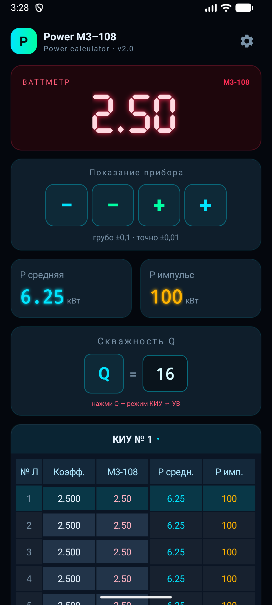

# PowerM3108

[License: MIT](https://img.shields.io/badge/License-MIT-yellow.svg)
[Platform](https://img.shields.io/badge/platform-Android-green.svg)

**PowerM3108** — Android-приложение «Калькулятор мощности» с таблицей результатов.

## Возможности

- Расчёт мощности.
- Таблица результатов вычислений.

## Скриншот

Главный экран приложения Power M3-108.

## Сборка

Требуется [Android Studio](https://developer.android.com/studio) и JDK 17.
Gradle Wrapper уже включён в проект (отдельная установка Gradle не нужна).

1. Склонируйте репозиторий:

   # GitVerse
   git clone https://gitverse.ru/zoolbazuzu/Power_M3-108.git

   # GitHub (зеркало)
   git clone https://github.com/zool81-coder/Power_M3_108.git

2. Перейдите в папку проекта:

   cd PowerM3108

3. Соберите приложение:

   # Windows (PowerShell)
   .\gradlew.bat assembleDebug

   # Linux/macOS
   ./gradlew assembleDebug

APK появится в `app/build/outputs/apk/debug/`.

## Запуск в Android Studio

1. Откройте проект в Android Studio (**Open** → папка `PowerM3108`).
2. Дождитесь синхронизации Gradle.
3. Подключите устройство или запустите эмулятор.
4. Нажмите **Run** (`Shift + F10`).

## Тестирование

    ./gradlew test   # unit-тесты
    ./gradlew lint   # проверка линтером

## Лицензия

Проект распространяется под лицензией [MIT](LICENSE).

## Автор

Степанов Алексей Александрович

- GitVerse: https://gitverse.ru/ZOOLBAZUZU
- GitHub: https://github.com/zool81-coder
